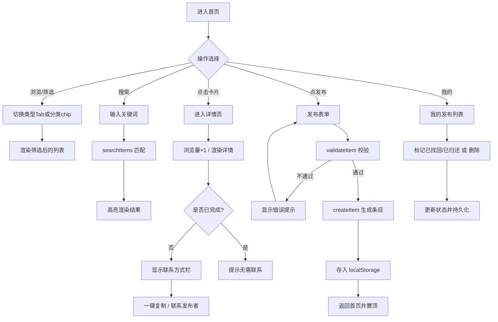
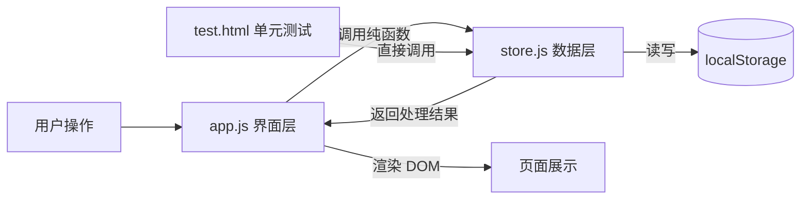

# 结对作业二：校园失物招领 —— 编码实现与单元测试

| 项目 | 内容 |
|---|---|
| 这个作业属于哪个课程 | [H202601软件工程与软件工程实践](https://edu.cnblogs.com/campus/fzu/2026-01SoftwareEngineeringandSoftwareEngineeringPractice) |
| 这个作业要求在哪里 | [2026秋软件工程结对作业(第二次)]https://edu.cnblogs.com/campus/fzu/2026-01SoftwareEngineeringandSoftwareEngineeringPractice/homework/16745 |
| 结对成员1 | 102402121 陈韦融（博客：https://www.cnblogs.com/rong-blog） |
| 结对成员2 | 102302113 王泽炜（博客：https://www.cnblogs.com/shiluojun） |
| GitHub 仓库地址 | https://github.com/Rong-hub1/102402121-102302113 |
| GitHub fork仓库地址 | https://github.com/shiluooo/102402121-102302113 |


## 一、具体分工

| 成员 | 分工 |
|---|---|
| 102402121 陈韦融 | 思路构建、整体应用设计与编码、美术风格设计、单元测试 test.html 编写、博客大纲构造 |
| 102302113 王泽炜 | 种子数据、界面走查与测试、bug修复、使用体验优化、test扩充、博客内容主体撰写、最终呈现核对 |

---

## 二、PSP 表格

| PSP2.1 阶段 | 预估耗时（分钟） | 实际耗时（分钟） |
|---|---:|---:|
| **Planning 计划** | 20 | 15 |
| Estimate 估计任务时间 | 20 | 15 |
| **Development 开发** | 505 | 505 |
| Analysis 需求分析（含学习） | 40 | 35 |
| Design Spec 生成设计文档 | 30 | 25 |
| Design Review 设计复审 | 20 | 15 |
| Coding Standard 代码规范 | 15 | 10 |
| Design 具体设计 | 40 | 35 |
| Coding 具体编码 | 240 | 260 |
| Code Review 代码复审 | 30 | 25 |
| Test 测试（自测、修改） | 90 | 100 |
| **Reporting 报告** | 70 | 55 |
| Test Report 测试报告 | 30 | 25 |
| Size Measurement 计算工作量 | 15 | 10 |
| Postmortem 事后总结与改进 | 25 | 20 |
| **合计** | **595** | **575** |


## 三、解题思路描述与设计实现说明

### 3.1 代码实现思路（文字描述）

本次在上一次原型设计的基础上，将其**从静态原型落地为可交互的单页应用（SPA）**。核心思路有三点：

1. **呈现形式**：选择 PC 端 Web，沿用原型的「手机框居中」方案——在浏览器中用一个 375×700 的手机外框居中展示，既忠实于原型设计（上次作业的思路）、降低改造成本，在较短时间内实现类似手机端网页的呈现，便于理解，同时便于后续开发，又保证在谷歌浏览器中打开 `index.html` 即可看到一致效果。

2. **数据层与界面层分离**：把所有数据处理逻辑抽进 `store.js`（纯函数、不操作 DOM），把页面渲染和事件响应放进 `app.js`。这样 `store.js` 可以**脱离界面被独立单元测试**，也让界面代码更清爽。数据持久化用浏览器 `localStorage`，无需后端，满足「下载即运行」。

3. **单页应用路由**：五个页面（首页 / 发布 / 详情 / 搜索 / 我的）实际是同一个 HTML 里的五个 `div`，通过 JS 切换 `active` 类实现「页面跳转」，避免多文件跳转的状态丢失，交互更流畅。

### 3.2 关键实现流程图 / 数据流图

**用户主流程图：**



**数据流转图：**



数据流上，所有数据变更都经过 `store.js` → `localStorage`，界面层只负责「拿数据渲染」和「把用户意图转成对 store 的调用」，保证数据单一可信源。

### 3.3 重要代码片段与解释

**① 数据校验 `validateItem`**——发布前的守门员，返回错误数组，空数组即通过。含时间格式校验和未来时间防护：

```javascript
function validateItem(data) {
  var errors = [];
  if (data.type !== 'lost' && data.type !== 'found')
    errors.push('类型必须为"寻物"或"招领"');
  if (!data.title || !String(data.title).trim())
    errors.push('物品名称不能为空');
  if (!data.location || !String(data.location).trim())
    errors.push('地点不能为空');
  // 时间：必填 + 格式正则 + 未来时间防护（宽容 1 分钟）
  if (!data.time || !String(data.time).trim()) {
    errors.push('时间不能为空');
  } else {
    var timeStr = String(data.time).trim();
    var timeRe = /^\d{4}-\d{2}-\d{2}[ T]\d{2}:\d{2}$/;
    if (!timeRe.test(timeStr)) {
      errors.push('时间格式不正确');
    } else {
      var ts = new Date(timeStr.replace(' ', 'T')).getTime();
      if (!isNaN(ts) && ts > Date.now() + 60000)
        errors.push('时间非法，请不要填写未来时间');
    }
  }
  if (!data.contact || !String(data.contact).trim())
    errors.push('联系方式不能为空');
  return errors;
}
```

> 设计要点：用「错误数组」而非「抛异常」表达校验结果，方便界面一次性展示所有缺失项；对字符串做 `trim()` 处理拦截「全空格」边界输入；时间校验是迭代中补的——初版只做了必填，人工测试后增加格式正则和未来时间防护。

**② 关键词搜索 `searchItems`**——在 7 个字段中模糊匹配（含 author、type 中文标签、时间），非数组输入安全返回空：

```javascript
function searchItems(items, keyword) {
  if (!Array.isArray(items)) return [];
  var kw = (keyword || '').trim().toLowerCase();
  if (kw === '') return items.slice();
  return items.filter(function (it) {
    var haystack = [
      it.title, it.description, it.location, it.category,
      it.time, (it.author || ''),
      (it.type === 'lost' ? '寻物 lost' : '招领 found')
    ].join(' ').toLowerCase();
    return haystack.indexOf(kw) !== -1;
  });
}
```

> 设计要点：统一转小写实现**不区分大小写**；把多个字段拼成一个串再匹配，代码简洁；非数组输入返回空数组而不是抛错，防止脏数据崩溃；haystack 里的 `it.author` 和 type 中文标签是人工测试后追加的——初版只搜 title/desc/location/category 四个字段。

**③ 高亮 + XSS 防护 `highlight`**——先转义再包裹高亮，支持关键词多次命中：

```javascript
function highlight(text, keyword) {
  var safe = escapeHtml(text == null ? '' : text);   // 先转义，防 XSS
  var kw = (keyword || '').trim();
  if (kw === '') return safe;
  var escaped = kw.replace(/[.*+?^${}()|[\]\\]/g, '\\$&'); // 转义正则特殊字符
  var re = new RegExp(escaped, 'gi');   // 全局匹配，支持多次命中
  return safe.replace(re, function (m) {
    return '<em class="hl">' + m + '</em>';
  });
}
```

> 设计要点：顺序很关键——**必须先 `escapeHtml` 再插入高亮标签**，否则恶意标题里的 `<script>` 会被执行；关键词里的正则元字符（如 `+`、`*`）也要转义，否则会报错或误匹配；`g` 标志让多个命中位置都高亮。

---

## 四、附加特点设计与展示

除作业要求的核心功能外，我们增加了以下人性化设计：

### 4.1 一键复制联系方式

- **创意与意义**：失主 / 拾获者最痛的点是「看到联系方式却要手动敲一遍」，尤其微信号、QQ 号易输错。一键复制让联系门槛降到最低。
- **实现思路**：优先用 `navigator.clipboard`，失败时回退到 `document.execCommand('copy')` 兼容旧环境；复制成功后用 Toast 反馈。
- **代码片段**：

```javascript
function copyContact() {
  var it = state.items.filter(x => x.id === state.detailId)[0];
  var text = it.contactType + '：' + it.contact;
  if (navigator.clipboard && navigator.clipboard.writeText) {
    navigator.clipboard.writeText(text).then(done).catch(() => fallbackCopy(text, done));
  } else {
    fallbackCopy(text, done);   // 兼容旧浏览器
  }
}
```

- **成果**：详情页点击「复制」即弹出 Toast「联系方式已复制：xxx」，实测可用。

### 4.2 分类筛选 chips + 已完成信息独立分层

- **创意与意义**：信息多了之后，按「证件卡片 / 电子产品 / 钥匙」等分类快速过滤，提升查找效率；**已完成的信息独立一个 tab 收纳**，不干扰进行中的浏览。
- **实现思路**：从现有数据动态聚合分类生成 chips；首页 typeTabs 增加第 4 个「已完成」tab，和「全部 / 寻物 / 招领」平级；`collectCategories` 根据当前筛选池动态收集可用分类。
- **实现成果**：
  - 首页 tab 栏：全部 / 寻物 / 招领 / **已完成** 四个 tab，一键切换
  - 顶部 chips 动态联动：选了"已完成"tab 后，下面分类 chips 只显示已完成条目的分类


### 4.3 PC 端横向拖拽滚动

- **创意与意义**：手机框里的分类 chips 超过一屏后需要横向滚动，但 PC 用户没有触摸板也看不到滚动条，以为不能滚。加一个"按住鼠标左键拖动"的交互。
- **实现思路**：写通用的 `enableDragScroll(el)` 函数——mousedown 记录起点 + mouseup 计算位移，拖动距离超过阈值时阻止 click 冒泡（防止"拖了一下就不小心点到 chip"）；CSS 加 `cursor: grab` / `cursor: grabbing` 视觉提示。
- **成果**：tab 栏和 chip 栏都能在 PC 上按住左右拖拽，体验和手机触摸一致。

### 4.4 防 XSS 注入的安全渲染

- 所有用户输入在渲染前都经 `escapeHtml` 转义，避免恶意标题 / 描述注入脚本。这是 Web 应用的基本安全素养，也是测试中的重点用例。

---

## 五、目录说明与使用说明

### 5.1 目录组织
（部分开发者用于沟通交流记录文件未标注）
```
第四次作业/
├── index.html          # 主页面（SPA 入口）
├── README.md           # 项目说明（目录 + 使用）
├── css/
│   └── style.css       # 全部样式
├── js/
│   ├── store.js        # 数据层纯函数（可单元测试）
│   ├── seed.js         # 首次访问示例数据
│   └── app.js          # 应用层：路由 / 渲染 / 事件
└── test/
    └── test.html       # 单元测试页
```

组织原则：**按职责分层**——样式、数据逻辑、界面逻辑、测试各自独立成文件，便于定位和维护。数据层独立，是为了能被单元测试直接调用。

### 5.2 测试人员如何运行

1.在GitHub仓库（见开头信息表）code → download zip
1. 用**谷歌浏览器**打开文件夹中 `index.html` → 直接使用全部功能；
2. 打开 `test/test.html` → 自动运行单元测试，顶部显示绿 / 红汇总。

无需安装任何环境、无需联网、无需服务器。

---

## 六、单元测试

### 6.1 测试工具选择与简易教程

**为什么选「浏览器内测试页」而非 Jest？** 作业要求「其他同学下载后用谷歌浏览器运行 HTML 即出结果」。Jest 依赖 Node.js 环境，助教若未配置则无法运行，与要求冲突。因此我们**自研了一个极简断言框架**，写在 `test/test.html` 里，打开即跑。

**框架核心只有 4 个函数**（简易教程）：

```javascript
test(group, name, fn)   // 注册一个用例：所属分组、用例名、测试函数
assert(cond, msg)       // 断言条件为真，否则抛出 msg
eq(a, b, msg)           // 断言 a、b 深度相等（用 JSON.stringify 比较）
assertThrow(fn, msg)    // 断言 fn 执行时会抛异常
```

用例运行后自动汇总：通过数、失败数、失败用例的具体期望值与实际值，顶部一条绿色 / 红色横幅一目了然。**任何同学打开 `test.html` 即可复现**，满足「单元测试自动化、人人可运行」。

### 6.2 测试代码与被测函数

针对 `store.js` 的每个纯函数设计用例，共 **52 个用例、9 个分组**，全部通过（48→52，人工测试后补齐边界）。覆盖的 store.js 函数：

| 函数 | 用例数 | 覆盖分支 |
|---|---|---|
| `validateItem` | 9 | 正常通过、type 非法、各字段为空、时间格式正则、未来时间防护、非对象输入 |
| `createItem` | 7 | 正常创建、自增 ID 不碰撞、contactType 默认值、description 默认空串、非法数据抛异常 |
| `searchItems` | 10 | 标题/描述/地点/分类/时间/author/type 标签匹配、空关键词返回全量、不区分大小写、多次命中高亮、非数组输入安全返回 |
| `filterByType` | 3 | all/lost/found、非数组输入 |
| `highlight` | 4 | 命中高亮、空关键词原样返回、多次命中、空/null 输入返回空串 |
| `escapeHtml` | 2 | 5 种字符转义、普通文本不变 |
| `timeAgo` | 6 | 刚刚/分钟前/小时前/天前/≥7天日期格式、空 ts 返回空串 |
| `markDone` / `reopenItem` / `removeItem` | 4 | 状态变更 + 不可变性（原数组不被修改） |
| `incrementViews` | 2 | 正常 +1、views=undefined 兜底变 1 |
| `saveItems` / `loadItems` / `clearItems` | 5 | 正常读写、非数组 JSON 容错、幂等循环一致性 |

示例：

```javascript
// 被测函数：searchItems（含 author 和 type 中文标签搜索）
test('searchItems 关键词搜索', '可按 type 中文标签"寻物"命中', function () {
  var r = S.searchItems([{ id:'a', type:'lost', title:'校园卡', /*...*/ }], '寻物');
  eq(r.length, 1);
});
test('searchItems 关键词搜索', '可按发布者 author 命中', function () {
  var r = S.searchItems([{ id:'a', author:'李明', /*...*/ }], '李明');
  eq(r.length, 1);
});

// 被测函数：validateItem（含未来时间防护）
test('validateItem 校验', '不允许未来时间', function () {
  var future = new Date(Date.now() + 86400000);
  var timeStr = future.getFullYear() + '-01-02 03:04';
  var e = S.validateItem({ type:'lost', title:'x', location:'x',
    time: timeStr, contact:'x' });
  assert(e.indexOf('时间非法') !== -1, e.join(','));
});

// 被测函数：incrementViews（含 undefined 兜底）
test('incrementViews 浏览量 +1', '初始 views 为 undefined 应安全变成 1', function () {
  var before = [{ id:'x', title:'a' }];  // 注意：没有 views 字段
  var r = S.incrementViews(before, 'x');
  eq(r[0].views, 1);
  eq(before[0].views, undefined);  // 原数组不变
});
```

### 6.3 测试数据构造思路（如何考虑各种情况 & 应对刁难）

采用**白盒 + 边界 + 异常 + 安全**四维设计，并在人工测试后针对性补齐漏洞：

| 维度 | 覆盖的情况 | 补齐来源 |
|---|---|---|
| 正常路径 | 合法数据校验通过、搜索命中、状态正确变更、持久化幂等 | 初始 36 条 |
| 边界值 | 空字符串关键词、全空格标题、时间刚好卡在「刚刚/分钟/小时/天/≥7天」临界点 | 初始 36 条 |
| 异常输入 | 非法 type、缺字段、`null`/`undefined` 传入数组参数、views=undefined、空 ts | 初始 + 补齐 4 条 |
| 安全 | 含 `<script>` 的恶意输入是否被转义、正则特殊字符关键词是否报错 | 初始 36 条 |
| 不可变性 | `markDone` / `incrementViews` / `removeItem` 是否误改原数组 | 初始 36 条 |
| 字段级覆盖 | `escapeHtml` 独立测试、`searchItems` author/type/time 搜索、`createItem` author 默认值 | **补齐 12 条**（人工测试后发现漏洞） |
| 未来防护 | 未来时间禁止发布、localStorage 脏数据容错（非数组） | **补齐 2 条**（人工测试 defect4） |

> 「应对刁难」思路：测试人员常拿空值、特殊字符、超长内容、未来日期来试。我们对所有字符串输入做 `trim()`、对 HTML 做转义、对非数组输入做防御性返回 `[]`、对时间做正则+未来校验，并用单元测试固化这些行为。**人工测试发现的漏洞 → 先补测试守护 → 再改代码**，保证每次迭代都有防回归的安全网。

**测试评价**：52 个用例覆盖了数据层全部函数的正常、边界、异常、安全与不可变性分支；界面层的交互流程通过人工走查（已实测发布 / 搜索 / 详情 / 标记 / 拖拽滚动全流程可用）补充。

---

## 七、实际操作预览

###7.1主页面


###7.2进入一个招领界面


###7.3发布启事


###7.4搜素


###7.5修改状态


###-篇幅限制不便展示，更多功能可以在GitHub仓库下载程序查看。

## 八、GitHub 代码签入记录

我负责的部分在第6次commit之后，前面5次是陈韦融负责将主体应用构建。
按功能划分模块、每完成一个可编译功能即 commit 一次。commit 信息采用「类型 + 简短描述」格式，PR #6 包含以下改动：

- ID 自增计数器消除碰撞风险；validateItem 时间格式正则校验
- 详情页浏览量 sessionStorage 去重，防止虚高
- 人工测试 defect1-4（已完成 tab、分类拖拽、author 搜索、未来时间）
- author 正式字段落地，hack 字符串移除；seed 数据加不同作者
- 补齐 16 条边界用例，测试从 36→52 条全绿
- 补充 README 目录说明与使用说明


PR #7 包含以下改动：
- 最终'博客草稿.md'文件修改
- 最终'README.md'文件修改


---

## 九、遇到的困难及解决方法

**问题描述**：
1. `test.html` 初次打开报 `SyntaxError`，所有测试无法运行；
2. 直接在搜索框按回车不触发搜索（仅点击「搜索」按钮有效）；
3. 内嵌脚本中写 `'</script>'` 测试 XSS 时，字符串被 HTML 解析器当成脚本结束标签；
4. 人工测试发现 4 个 defect：已完成条目混在一起、分类 chips 不能横向滚动（CSS 加了 overflow 但隐藏了滚动条，PC 用户看不到）、搜不到发布者名字、可以发布未来时间；
5. 搜索"发布者"三个字不应该搜到内容，但初版用 hack 字符串把"匿名同学 发布者"拼进了 haystack，导致"发布者"也能命中；
6. ID 生成 `Date.now() + 随机数` 有碰撞风险；详情页浏览量反复打开会虚高。

**做过哪些尝试**：
1. 查看浏览器控制台，定位到语法错误指向测试用例行；
2. 检查 `app.js` 的 `keydown` 监听，确认代码本身正确；
3. 排查发现是 HTML 中 `</script>` 字面量提前终止了脚本块；
4. 分类滚动先试了 CSS `overflow-x:auto` + `-webkit-overflow-scrolling:touch`，但滚动条被 `::-webkit-scrollbar { display:none }` 隐藏，PC 用户看不到也没法拖。后来加了通用 `enableDragScroll(el)` 拖拽滚动函数——mousedown + mousemove 计算位移，拖动距离超过阈值时阻止 click 冒泡；
5. author 搜索一开始 hack 字符串，但用户指出"发布者"不应作为检索内容。彻底让 author 成为 item 结构体正式字段，hack 字符串删除；
6. ID 从 `Date.now() + Math.random()` 改成模块级自增计数器 `ID_COUNTER`，同一次运行内永不碰撞。

**是否解决**：
1. 已解决——将 `'</script>'` 拆成 `'<' + '/script>'` 拼接，避免被解析器识别为结束标签；
2. 回车问题系测试工具焦点所致，真实浏览器中输入框回车正常触发（代码已监听 `keydown`），并保留「搜索」按钮作为双保险；
3. 全部 52 个用例通过；
4. defect1-4 全部修复，已发 PR #1；
5. author 正式字段落地，搜索逻辑干净；
6. 自增计数器 + sessionStorage 去重均已落地。

**收获**：
- 纯函数与界面分离后，测试极其顺畅——数据层 bug 能在 `test.html` 里秒级复现，不必在界面里反复点；
- HTML 内嵌脚本的 `</script>` 陷阱是个经典坑，写测试页时需格外注意；
- **"hack 字符串先跑通 → 用户指出语义不对 → 正式字段落地"** 这个过程让我体会到：**脏代码在迭代中迟早会被发现，不如一开始就设计成结构体的一等公民**；
- PC 端和移动端的交互不能假设一致——手机触摸板天然能滑的东西，PC 端需要拖拽或可见滚动条；
- 人工测试非常值钱——单元测试覆盖的是"我想得到的边界"，但人工测试会撞上"我没想到的场景"（比如已完成条目混在一起、搜不到"寻物"标签）。

---

## 十、评价我的队友

**值得学习的地方**：陈韦融的应用原型设计做的很完善，基本应用需求都有完成，也做到了从仓库安装到本地即可直接使用。美术风格也和当初构想的一样模拟了在手机上应用的情况。出版的单元测试用例也包含了几乎所有方面。

**需要改进的地方**：本次我们采取的是一个人将整体项目基础做完，另一个人负责进行测试，然后修改bug优化代码。感觉这种方式各有优劣，但可能不够适合二人组队开发的项目。一开始想的是这样更符合用户和开发者的不同视角，对于初版程序确实发现了很多使用体验很差的地方进行修改，但是感觉工作量相对较大，毕竟不是代码的第一作者。下次可以尝试一人做一部分，然后互相进行对应测试，再让对应开发者去修改自己的代码。