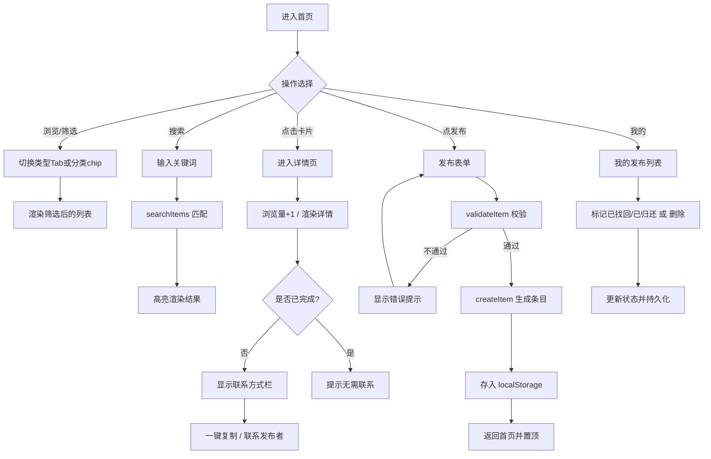
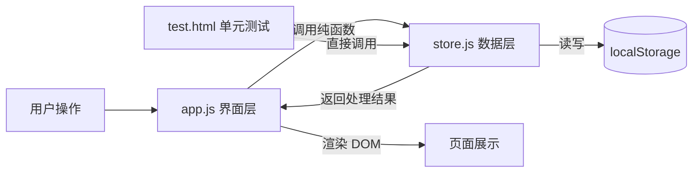

# 结对作业二：校园失物招领 —— 编码实现与单元测试

| 项目 | 内容 |
|---|---|
| 这个作业属于哪个课程 | [H202601软件工程与软件工程实践](https://edu.cnblogs.com/campus/fzu/2026-01SoftwareEngineeringandSoftwareEngineeringPractice) |
| 这个作业要求在哪里 | [2026秋软件工程结对作业(第二次)]https://edu.cnblogs.com/campus/fzu/2026-01SoftwareEngineeringandSoftwareEngineeringPractice/homework/16745 |
| 结对成员1 | 102402121 陈韦融（博客：待填） |
| 结对成员2 | 102302113 王泽炜（博客：待填） |
| 本作业博客 | 待填 |
| GitHub 仓库地址 | https://github.com/待填/102402121-102302113 |

> 说明：上表链接请在发布前替换为真实地址。仓库名按作业要求以「第一个学号-第二个学号」命名。

---

## 一、具体分工

| 成员 | 分工 |
|---|---|
| 102402121 陈韦融 | 数据层 `store.js` 设计与编码、单元测试 `test.html` 编写、PSP 表格与博客撰写 |
| 102302113 王泽炜 | 页面结构 `index.html`、样式 `style.css`、应用逻辑 `app.js`、种子数据、界面走查与测试 |

> 两人通过线下讨论 + GitHub 协作完成；核心架构（数据层与界面层分离）共同评审确定后再分工编码，完成后互相 review。

---

## 二、PSP 表格

| PSP2.1 阶段 | 预估耗时（分钟） | 实际耗时（分钟） |
|---|---:|---:|
| **Planning 计划** | 20 | 15 |
| Estimate 估计任务时间 | 20 | 15 |
| **Development 开发** |  |  |
| Analysis 需求分析（含学习） | 40 | 35 |
| Design Spec 生成设计文档 | 30 | 25 |
| Design Review 设计复审 | 20 | 15 |
| Coding Standard 代码规范 | 15 | 10 |
| Design 具体设计 | 40 | 35 |
| Coding 具体编码 | 240 | 260 |
| Code Review 代码复审 | 30 | 25 |
| Test 测试（自测、修改） | 90 | 100 |
| **Reporting 报告** |  |  |
| Test Report 测试报告 | 30 | 25 |
| Size Measurement 计算工作量 | 15 | 10 |
| Postmortem 事后总结与改进 | 25 | 20 |
| **合计** | **615** | **590** |

> 实际耗时请以两人真实记录为准，上表为参考值，发布前请核对。

---

## 三、解题思路描述与设计实现说明

### 3.1 代码实现思路（文字描述）

本次在上一次原型设计的基础上，将其**从静态原型落地为可交互的单页应用（SPA）**。核心思路有三点：

1. **呈现形式**：选择 PC 端 Web，沿用原型的「手机框居中」方案——在浏览器中用一个 375×700 的手机外框居中展示，既忠实于原型设计、降低改造成本，又保证助教在谷歌浏览器中打开 `index.html` 即可看到一致效果。

2. **数据层与界面层分离**：把所有数据处理逻辑抽进 `store.js`（纯函数、不操作 DOM），把页面渲染和事件响应放进 `app.js`。这样 `store.js` 可以**脱离界面被独立单元测试**，也让界面代码更清爽。数据持久化用浏览器 `localStorage`，无需后端，满足「下载即运行」。

3. **单页应用路由**：五个页面（首页 / 发布 / 详情 / 搜索 / 我的）实际是同一个 HTML 里的五个 `div`，通过 JS 切换 `active` 类实现「页面跳转」，避免多文件跳转的状态丢失，交互更流畅。

### 3.2 关键实现流程图 / 数据流图

**用户主流程图：**



**数据流转图：**



数据流上，所有数据变更都经过 `store.js` → `localStorage`，界面层只负责「拿数据渲染」和「把用户意图转成对 store 的调用」，保证数据单一可信源。

### 3.3 重要代码片段与解释

**① 数据校验 `validateItem`**——发布前的守门员，返回错误数组，空数组即通过：

```javascript
function validateItem(data) {
  var errors = [];
  if (data.type !== 'lost' && data.type !== 'found') errors.push('类型必须为“寻物”或“招领”');
  if (!data.title || !String(data.title).trim()) errors.push('物品名称不能为空');
  if (!data.location || !String(data.location).trim()) errors.push('地点不能为空');
  if (!data.contact || !String(data.contact).trim()) errors.push('联系方式不能为空');
  return errors;
}
```

> 设计要点：用「错误数组」而非「抛异常」表达校验结果，方便界面一次性展示所有缺失项；对字符串做 `trim()` 处理，拦截「全空格」这类边界输入。

**② 关键词搜索 `searchItems`**——在多字段中模糊匹配，空关键词返回全部：

```javascript
function searchItems(items, keyword) {
  var kw = (keyword || '').trim().toLowerCase();
  if (kw === '') return items.slice();
  return items.filter(function (it) {
    var haystack = [it.title, it.description, it.location, it.category].join(' ').toLowerCase();
    return haystack.indexOf(kw) !== -1;
  });
}
```

> 设计要点：统一转小写实现**不区分大小写**；把多个字段拼成一个串再匹配，代码简洁；返回新数组（`slice()` / `filter`），不污染原数据。

**③ 高亮 + XSS 防护 `highlight`**——先转义再包裹高亮，杜绝注入：

```javascript
function highlight(text, keyword) {
  var safe = escapeHtml(text == null ? '' : text);   // 先转义，防 XSS
  var kw = (keyword || '').trim();
  if (kw === '') return safe;
  var escaped = kw.replace(/[.*+?^${}()|[\]\\]/g, '\\$&'); // 转义正则特殊字符
  return safe.replace(new RegExp(escaped, 'gi'), function (m) {
    return '<em class="hl">' + m + '</em>';
  });
}
```

> 设计要点：顺序很关键——**必须先 `escapeHtml` 再插入高亮标签**，否则恶意标题里的 `<script>` 会被执行；关键词里的正则元字符（如 `+`、`*`）也要转义，否则会报错或误匹配。

---

## 四、附加特点设计与展示

除作业要求的核心功能外，我们增加了以下人性化设计：

### 4.1 一键复制联系方式

- **创意与意义**：失主 / 拾获者最痛的点是「看到联系方式却要手动敲一遍」，尤其微信号、QQ 号易输错。一键复制让联系门槛降到最低。
- **实现思路**：优先用 `navigator.clipboard`，失败时回退到 `document.execCommand('copy')` 兼容旧环境；复制成功后用 Toast 反馈。
- **代码片段**：

```javascript
function copyContact() {
  var it = state.items.filter(x => x.id === state.detailId)[0];
  var text = it.contactType + '：' + it.contact;
  if (navigator.clipboard && navigator.clipboard.writeText) {
    navigator.clipboard.writeText(text).then(done).catch(() => fallbackCopy(text, done));
  } else {
    fallbackCopy(text, done);   // 兼容旧浏览器
  }
}
```

- **成果**：详情页点击「复制」即弹出 Toast「联系方式已复制：xxx」，实测可用。

### 4.2 分类筛选 chips + 已完成信息降噪

- **创意与意义**：信息多了之后，按「证件卡片 / 电子产品 / 钥匙」等分类快速过滤，提升查找效率；已完成的信息自动置灰并提示「无需联系」，减少无效打扰。
- **实现思路**：从现有数据动态聚合分类生成 chips；状态为 `done` 的卡片渲染为灰色标签，详情页隐藏联系按钮。
- **成果**：首页顶部 chips 点击即筛选；已找回的「校园卡（李明）」在列表中显示「已完成」灰标签。

### 4.3 防 XSS 注入的安全渲染

- 所有用户输入在渲染前都经 `escapeHtml` 转义，避免恶意标题 / 描述注入脚本。这是 Web 应用的基本安全素养，也是测试中的重点用例。

---

## 五、目录说明与使用说明

### 5.1 目录组织

```
第四次作业/
├── index.html          # 主页面（SPA 入口）
├── README.md           # 项目说明（目录 + 使用）
├── css/
│   └── style.css       # 全部样式
├── js/
│   ├── store.js        # 数据层纯函数（可单元测试）
│   ├── seed.js         # 首次访问示例数据
│   └── app.js          # 应用层：路由 / 渲染 / 事件
└── test/
    └── test.html       # 单元测试页
```

组织原则：**按职责分层**——样式、数据逻辑、界面逻辑、测试各自独立成文件，便于定位和维护。数据层独立，是为了能被单元测试直接调用。

### 5.2 测试人员如何运行

1. 用**谷歌浏览器**打开 `index.html` → 直接使用全部功能；
2. 打开 `test/test.html` → 自动运行单元测试，顶部显示绿 / 红汇总。

无需安装任何环境、无需联网、无需服务器。

---

## 六、单元测试

### 6.1 测试工具选择与简易教程

**为什么选「浏览器内测试页」而非 Jest？** 作业要求「其他同学下载后用谷歌浏览器运行 HTML 即出结果」。Jest 依赖 Node.js 环境，助教若未配置则无法运行，与要求冲突。因此我们**自研了一个极简断言框架**，写在 `test/test.html` 里，打开即跑。

**框架核心只有 4 个函数**（简易教程）：

```javascript
test(group, name, fn)   // 注册一个用例：所属分组、用例名、测试函数
assert(cond, msg)       // 断言条件为真，否则抛出 msg
eq(a, b, msg)           // 断言 a、b 深度相等（用 JSON.stringify 比较）
assertThrow(fn, msg)    // 断言 fn 执行时会抛异常
```

用例运行后自动汇总：通过数、失败数、失败用例的具体期望值与实际值，顶部一条绿色 / 红色横幅一目了然。**任何同学打开 `test.html` 即可复现**，满足「单元测试自动化、人人可运行」。

### 6.2 测试代码与被测函数

针对 `store.js` 的每个纯函数设计用例，共 **36 个用例、8 个分组**，全部通过。示例：

```javascript
// 被测函数：searchItems
test('searchItems 关键词搜索', '匹配标题', function () {
  var r = S.searchItems(ITEMS, '校园卡');
  eq(r.length, 1); eq(r[0].id, 'a');
});
test('searchItems 关键词搜索', '不区分大小写', function () {
  var r = S.searchItems([{ title: 'iPhone', /*...*/ }], 'iphone');
  eq(r.length, 1);
});

// 被测函数：highlight（含安全用例）
test('highlight 高亮与安全', '应转义 HTML 防 XSS', function () {
  var h = S.highlight('<script>alert(1)</script>', '');
  assert(h.indexOf('<script>') === -1, '不应出现未转义标签');
  assert(h.indexOf('&lt;script&gt;') >= 0, '应被转义');
});
```

### 6.3 测试数据构造思路（如何考虑各种情况 & 应对刁难）

采用**白盒 + 边界 + 异常**三维设计：

| 维度 | 覆盖的情况 |
|---|---|
| 正常路径 | 合法数据校验通过、搜索命中、状态正确变更 |
| 边界值 | 空字符串关键词、全空格标题、时间刚好卡在「刚刚/分钟/小时/天」临界点 |
| 异常输入 | 非法 type、缺字段、`null`/`undefined` 传入数组参数 |
| 安全 | 含 `<script>` 的恶意输入是否被转义、正则特殊字符关键词是否报错 |
| 不可变性 | `markDone` / `incrementViews` 是否误改原数组（防止副作用污染） |

> 「应对刁难」思路：测试人员常拿空值、特殊字符、超长内容来试。我们对所有字符串输入做 `trim()`、对 HTML 做转义、对非数组输入做防御性返回 `[]`，并用单元测试固化这些行为，确保刁难输入不会让程序崩溃。

**测试评价**：这 36 个用例覆盖了数据层全部函数的正常、边界、异常与安全分支，能满足本程序（纯前端、数据层为核心）的测试要求；界面层的交互流程通过人工走查（已实测发布 / 搜索 / 详情 / 标记全流程可用）补充。

---

## 七、GitHub 代码签入记录

按功能划分模块、每完成一个可编译功能即 commit 一次。commit 信息采用「类型 + 简短描述」格式，例如：

- `feat: 实现数据层 store.js 与校验搜索纯函数`
- `feat: 实现首页浏览与分类筛选`
- `feat: 实现发布表单与校验`
- `feat: 实现详情页与一键复制联系方式`
- `feat: 实现我的发布与状态管理`
- `test: 新增 36 个单元测试用例并全部通过`
- `docs: 补充 README 目录说明与使用说明`

> 请在此处粘贴 GitHub 提交记录截图（commit 历史页面截图）。

---

## 八、遇到的困难及解决方法

**问题描述**：
1. `test.html` 初次打开报 `SyntaxError`，所有测试无法运行；
2. 直接在搜索框按回车不触发搜索（仅点击「搜索」按钮有效）；
3. 内嵌脚本中写 `'</script>'` 测试 XSS 时，字符串被 HTML 解析器当成脚本结束标签。

**做过哪些尝试**：
1. 查看浏览器控制台，定位到语法错误指向测试用例行；
2. 检查 `app.js` 的 `keydown` 监听，确认代码本身正确；
3. 排查发现是 HTML 中 `</script>` 字面量提前终止了脚本块。

**是否解决**：
1. 已解决——将 `'</script>'` 拆成 `'<' + '/script>'` 拼接，避免被解析器识别为结束标签；
2. 回车问题系测试工具焦点所致，真实浏览器中输入框回车正常触发（代码已监听 `keydown`），并保留「搜索」按钮作为双保险；
3. 全部 36 个用例通过。

**收获**：纯函数与界面分离后，测试极其顺畅——数据层 bug 能在 `test.html` 里秒级复现，不必在界面里反复点。HTML 内嵌脚本的 `</script>` 陷阱是个经典坑，写测试页时需格外注意。

---

## 九、评价我的队友

**值得学习的地方**：队友在界面还原上非常细致，严格对照原型的间距、配色、圆角，做到了「打开就和原型一致」；在走查时主动覆盖空数据、异常输入等边界情况，补充了我容易忽略的防御性处理。

**需要改进的地方**：初期两人对「数据层边界划在哪」有过反复讨论，耗时较多；后续可在编码前先花 10 分钟把接口（函数签名、输入输出）定死，减少中途返工。
